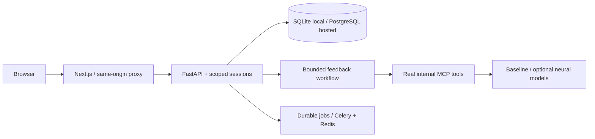

# OTCaseLab AI

An original fictional occupational-therapy education prototype connecting patient priorities, image observations and functional goals. English, Urdu script and Roman Urdu text are supported. Feedback is provisional and educator amendments remain visible.

**Yeh taleemi prototype hai:** student farzi patient se interview karta hai, image par apni observations likhta hai aur goal ki wajah samjhata hai. Cases abhi educator review ke muntazir hain. Neural inference chal chuki hai, lekin learning benefit aur language fairness validate nahin hui.

The repository includes a Next.js student/educator interface, FastAPI/SQLAlchemy persistence, opaque cookie sessions/CSRF, original case/rubric drafts, lexical feedback with exact learner spans, optional genuine provider adapters, actual pretrained NLP/CV paths, a bounded real MCP workflow, synthetic ML mechanics and a VM deployment stack. Current executed checks and remaining gates are in [implementation state](docs/IMPLEMENTATION_STATE.md).



## Local start

Requirements: Python 3.12, `uv` (verified local 0.10.8), Node.js compatible with Next 16 (verified host 24.19.0; container 22.23.3), npm. No API key is needed in scripted mode. Python and npm dependency versions are locked.

```bash
cp .env.example .env
uv sync --frozen --extra dev
uv run alembic upgrade head
uv run python -m services.api.seed
npm ci --prefix apps/web
make dev
```

Open `http://localhost:3005`. The seed creates **random local credentials** in `.runtime/demo-credentials.json` with private file permissions. Open that file locally to sign in as student or educator; it is ignored by Git. Existing seeded accounts are not silently reset. There is no default production password.

If running services separately:

```bash
uv run uvicorn services.api.main:app --host 127.0.0.1 --port 8000
npm run --prefix apps/web dev
```

The five cases start pending review. `ALLOW_DEMO=true` exposes explicitly eligible fictional drafts; `ALLOW_DEMO=false` requires published reviewed content and disables open registration. In production, provision approved users through the password-prompt CLI. Study content review and publication are separate from model/learning validation.

## Run checks and actual inference

```bash
uv run --extra dev pytest -q
uv run --extra dev ruff check services ai ml tests infra data/demo
npm run --prefix apps/web typecheck
npm run --prefix apps/web build
# With the API running and demo seeded; Playwright config starts/reuses the web app:
npm run --prefix apps/web test:e2e
uv run python -m ai.evaluate
uv run python -m services.mcp.smoke
uv run python -m ml.train --synthetic
```

For actual pretrained CPU model inference (downloads weights; needs more RAM/time):

```bash
uv sync --frozen --extra dev --extra neural
.venv/bin/python -m ai.model_smoke --component cv --output ml/reports/cv-smoke.json
.venv/bin/python -m ai.model_smoke --component nlp --output ml/reports/nlp-neural-smoke.json
```

Select `NLP_MODE=neural` / `CV_MODE=neural` only with those dependencies/weights available. Optional `PROVIDER_MODE=anthropic` requires a genuine server-side key and compatible model ID; no live provider test is claimed without credentials. Normal `uv run` can synchronize extras, so use the explicit neural extra or the already-installed interpreter for neural runs.

Recorded reports include a real neural Roman Urdu abstention, a schematic CV failure example, and a real logistic fit on synthetic mechanics rows. They do not prove educational accuracy, clinical suitability, language fairness or improved learning. No fine-tuning or human study is claimed. The deployed recommendation remains a transparent rule; draft references are not retrievable until reviewed publication. See [model cards](docs/MODEL_CARDS.md) and [dataset card](docs/DATASET_CARD.md).

## Deployment and handover

[Deployment guide](docs/DEPLOYMENT.md) gives the default Linux VM/Compose/Caddy path. [Runbook](docs/RUNBOOK.md) contains migration, backup, disposable restore, rollback and restart commands. Local containers are not a public deployment; an authorized VM, domain/DNS, server-side secrets, staging HTTPS smoke and cohort release gate remain necessary.

[Documentation index](docs/README.md) links requirements, architecture, prior-art refresh, annotations, benchmark protocol, capability matrix and truthful portfolio materials. The original input is analyzed against real deliverables; pending educator/data/credentials/hosting gates are recorded explicitly.
