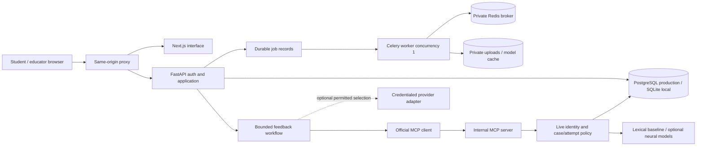
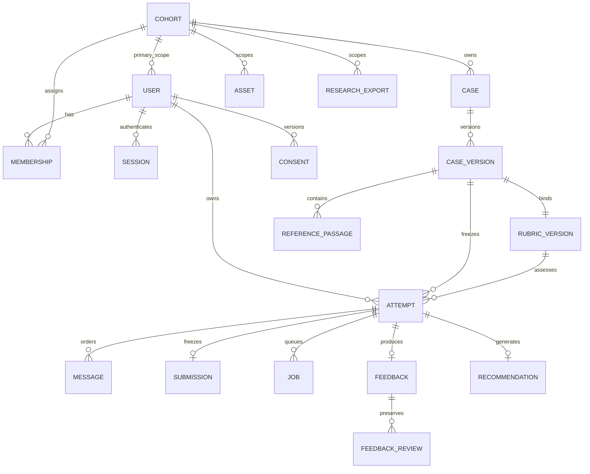

# Architecture and key decisions

Version 0.1 — 1 October 2026. OTCaseLab is a modular monolith with a background worker and an internal MCP tool surface. The database is the authority for identity, attempt state, consent and case scope; model text never establishes permissions.



In development, Next rewrites `/api/` to local FastAPI. In production, Caddy terminates HTTPS and routes `/api/` directly to the API; all other browser traffic goes to Next. Only Caddy has public ports. PostgreSQL, Redis, MCP, web and API share a private Compose network. The application uses cookie sessions, CSRF tokens and an exact application Origin. The internal HTTP MCP transport requires a separate bearer token plus an attempt-bound signed scope token. Local stdio also uses signed scope and live database policies.

```mermaid
sequenceDiagram
  participant U as Learner
  participant API
  participant DB
  participant A as Bounded workflow
  participant C as MCP client
  participant M as MCP server / policy bridge
  U->>API: Submit plan + session/CSRF + idempotency key
  API->>DB: Verify owner; freeze plan + checksum
  API->>A: Server-bound learner/cohort/attempt scope
  A->>C: Initialize + discover tools
  C->>M: Case / extraction / approved evidence / rubric calls
  M->>DB: Recheck current ownership and version
  M-->>C: Bounded structured result
  A->>C: Save traceable provisional feedback once
  C->>M: Signed write scope + stable key
  M->>DB: Preserve feedback and recommendation
  API-->>U: Provisional report / explicit failure
```

## Data model

The ER diagram reflects SQLAlchemy entities. Case facts, original rubric dimensions and asset annotations are versioned JSON content within relational ownership records; they are not independent normalized ontology tables.



Audit events deliberately store action/scope metadata rather than full dialogue. ModelRegistry records model manifests/artifact status. Foreign keys, unique attempt feedback/submission/recommendation constraints and ordered message constraints guard persistence. Deletion eligibility and retained audit records need institutional retention policy before real deployment.

## Architecture decisions

| ADR | Decision and reason | Consequence / revisit condition |
|---|---|---|
| 001 | FastAPI/SQLAlchemy monolith and one shared Python lock | Shared policies across API, worker and MCP; split services only for measured scaling/conflicts |
| 002 | Opaque HttpOnly cookie sessions, Argon2 credential hashes and CSRF | Server can revoke session; same-origin proxy avoids browser token storage |
| 003 | SQLite local and PostgreSQL production with migrations | Easy credential-free demo; production config rejects SQLite; verify both database behaviors |
| 004 | Database job records + Celery/Redis in hosted mode | Job ownership/deduplication outlive process; concurrency 1 protects CPU/RAM until measured |
| 005 | Lexical retrieval of approved case passages first | Transparent source provenance; vector search waits for a meaningful reviewed benchmark |
| 006 | Optional CPU pretrained models, lazy-load/unload where implemented | Neural modules require downloaded weights and more RAM; thread/process peaks must be benchmarked |
| 007 | Constrained provider selects exact permitted utterance IDs | Factual generation is bounded; richer dialogue requires future fidelity evidence |
| 008 | VM Compose/Caddy default deployment | One operational path; no hosting purchase, DNS change or live release is inferred from local containers |
| 009 | Numeric JSON recommendation artifacts, synthetic promotion denied | Avoid untrusted pickle loading; expert-labelled model promotion remains a research gate |
| 010 | Original CC0 schematics for demo, annotations pending | No third-party asset dependency; photographic CV benchmark remains unavailable |

Service images use fixed version tags checked against the Docker official image catalog. Tags are not immutable digests; record actual digests from a build/pull before an authorized release. No concurrency/cost promise follows from the topology. See [runbook](RUNBOOK.md) and [model cards](MODEL_CARDS.md).
