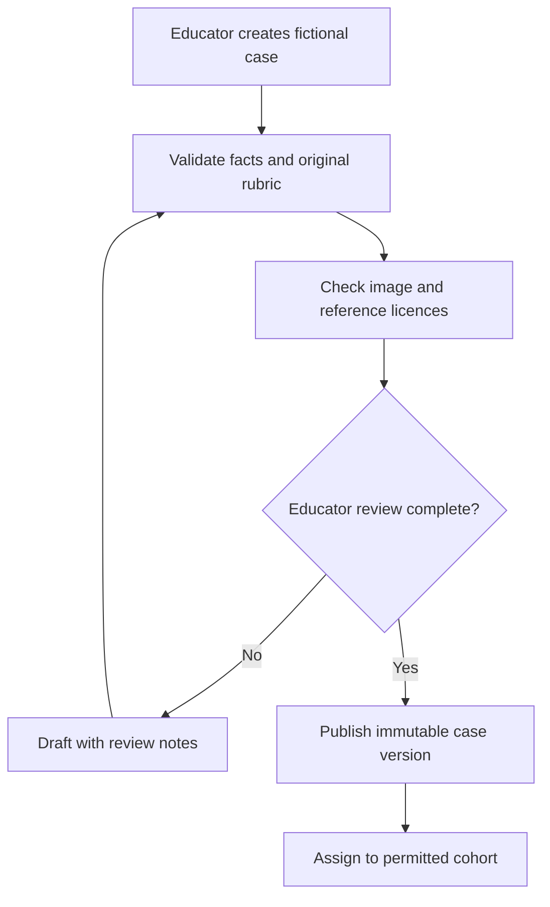
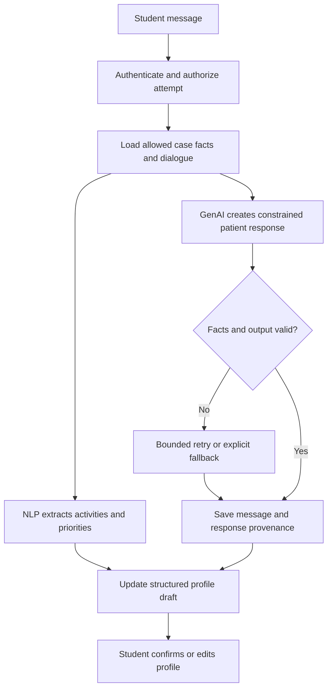
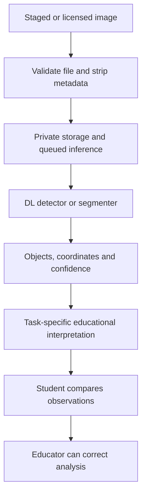
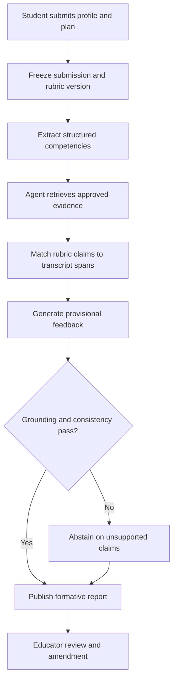
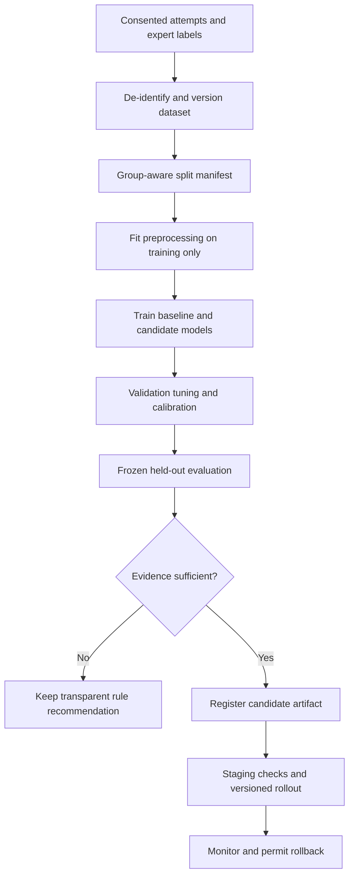
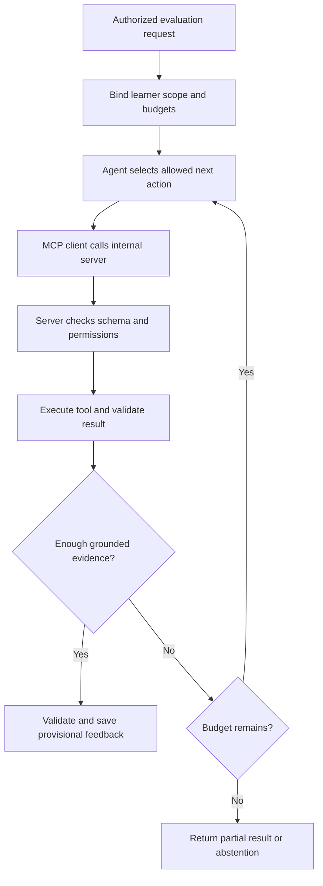
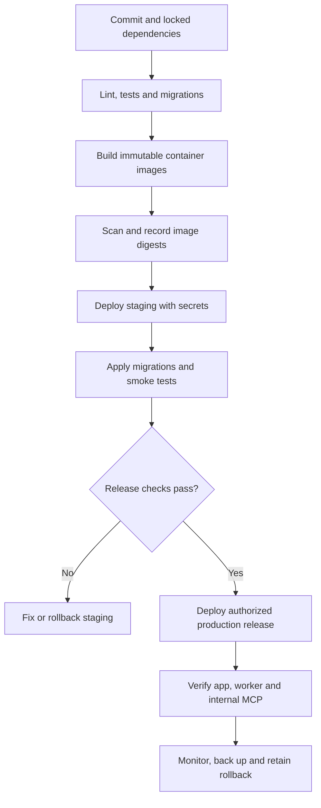

# OTCaseLab AI — A-to-Z Implementation Master Prompt

**Version:** 1.1 — competitor-informed revision  
**Prepared:** 1 October 2026  
**Deliverable:** A reusable implementation prompt and pipeline specification, not an already-built application.

## How to use / Istemaal ka tareeqa

1. Neeche **BEGIN MASTER PROMPT** se **END MASTER PROMPT** tak poora text apne coding assistant ko dein.
2. Coding workspace available ho to assistant actual files create kare, commands run kare aur checks complete kare. Sirf chat available ho to woh complete runnable files aur commands ordered batches mein de.
3. Explanations Roman Urdu mein aur code, identifiers aur technical documentation English mein maange gaye hain.
4. Har stage ka checkpoint save karein. Nayi conversation mein prompt ke saath `docs/IMPLEMENTATION_STATE.md` aur relevant repository files dein.
5. Cloud credentials aur actual secrets prompt mein paste na karein. Environment variables ya hosting secret manager use karein.
6. ML training ke liye expert-labelled data chahiye. Synthetic demo data se pipeline test ho sakti hai; us se real student performance ki validity prove nahi hoti.
7. Is revision mein competitor overlap, focused first milestone, learning benchmarks aur feature priorities add ki gayi hain. Pehla milestone ek complete case hai; full educational demo aur advanced release ke criteria alag hain.

---

# BEGIN MASTER PROMPT

## 1. Your role and assignment

Act as a senior full-stack engineer, applied AI engineer, ML researcher, data engineer, occupational therapy education collaborator, and deployment engineer. These are responsibilities of one implementation assistant; delegation is not required.

Build **OTCaseLab AI**, a browser-based, multimodal occupational therapy education platform. Deliver a working repository, reproducible data and model pipelines, meaningful evaluation, an authenticated MCP integration, and deployment instructions/configuration. When tools and authorization permit, implement and verify the application rather than stopping at a plan.

Explain each implementation stage in clear Roman Urdu suitable for an OT student learning software development. Write source code, file names, API contracts and technical documentation in English. Explain abbreviations on first use. Be practical and concrete.

Do not claim files were created, commands passed, a model was trained, or a site was deployed unless those actions actually occurred. Keep planned work, mock operation, expert review, and evaluated operation visibly separate.

## 2. Product context and constraints

- The project owner is an occupational therapy student in Pakistan.
- Goals: useful OT education, advanced software/AI engineering, research potential, a demonstrable portfolio, and credible professional visibility.
- Required technologies: machine learning, deep learning, NLP, computer vision, generative AI, agentic AI, MCP, and deployment.
- No special user hardware: no sensors, wearables, robotics, EEG, VR headset, or mandatory webcam/microphone.
- Text input and supplied/uploaded educational images must be sufficient. Ordinary browser and computer access is assumed. Cloud compute may be required and is not automatically free.
- Primary audience: OT students and OT educators. This is an educational simulation, not a clinical diagnostic, prescribing, or patient-treatment service.
- Primary release: adult physical rehabilitation cases involving occupational profiles, self-care, home environment and work participation. Add other domains only after the initial evaluation.
- Start with five fictional cases and staged/licensed environment images. Mark unreviewed examples as such. Educator approval is required before presenting a case as reviewed educational content.
- Support English, Urdu script and Roman Urdu text. Implement correct RTL display for Urdu without changing the direction of code, numbers or English identifiers.
- A demonstration should show an interview, an occupational profile, image observations, a submitted plan, traceable feedback and a next-practice recommendation.
- The proposed Pakistani niche is OT-specific bilingual virtual-patient training. Do not claim Pakistan-first, global novelty, improved learning, CV performance, or LinkedIn reach without evidence.

## 2A. Competitive positioning and first-release priorities

This section refines the implementation priorities; it does not remove any required technology. The first complete journey is one adult stroke/home-activity educational case. Grow it into the five-case educational demonstration specified elsewhere, then the data-dependent advanced release.

### Verified overlap, not a claim of superiority

The following public primary product pages were reviewed on 1 October 2026. They describe vendor/platform capabilities; they are not independent performance comparisons and no paid product trial was conducted.

| Platform | Publicly described overlap | Implication |
|---|---|---|
| [Simucase OT](https://www.simucase.com/occupational-therapy) | OT assessment/intervention simulations, part-task trainers and observation videos; includes ADL and environmental accessibility topics | OT-specific simulation and environment-related content are already offered. Do not claim uniqueness from these labels. |
| [Stanford Clinical Mind AI](https://clinicalmindai.stanford.edu/platform/main-functionalities) | Custom virtual patients, rubrics, clinical-case activities and course assignments | Case authoring, AI dialogue and rubric-based feedback are expected competitive capabilities. |
| [SimPatient](https://simpatient.co.uk/pricing) | Text/voice/video modes, custom rubrics, educator analytics and tutor review | Text interaction, educator oversight and analytics alone are not differentiators. |
| [VPS Clinical](https://vpsclinical.com/product/) | Allied-health AI patients, educator-controlled scenarios, feedback and browser access without specialized hardware | Hardware-free delivery and educator control are not exclusive advantages. |

Refresh this analysis during Stage A. Use the feature statuses `documented`, `tested`, `unknown` and `not applicable`. Never convert an undocumented competitor feature into a confident `absent` label. Do not infer case quality, learning gains, market size or technical implementation from marketing claims.

### Proposed focused positioning

Build an **OT clinical-reasoning trainer for Pakistani educational settings**, linking bilingual occupational interviewing to environment observations and patient-prioritized functional goals. Validate the actual need with educators/students and map objectives to their current course materials rather than claiming automatic national curriculum compliance.

Primary learning objective: the student can justify a functional goal using both patient-reported priorities and visible/contextual environmental evidence. The initial case focuses on a fictional adult after stroke with a home/self-care concern. It is an educational reasoning task, not a motor examination or clinical recommendation for a real patient.

Possible local context must come from the individual fictional case, not stereotypes: shared household routines, floor or chair seating preferences, clothing choices, family assistance, locally relevant work and access to equipment. Learners should ask about these preferences rather than assume them. Case authors must offer varied resources, household structures and occupations.

### Three hypotheses to test

1. **Bilingual assessment fairness:** feedback remains consistent when equivalent learner reasoning is expressed in English, Urdu script or Roman Urdu. This is a performance requirement, not just translated labels.
2. **Combined reasoning:** an interview-plus-image exercise improves integration of occupational priorities and environmental context on a new task compared with a matched interview-only exercise.
3. **Traceable feedback:** showing the learner's exact supporting text, rubric criterion and approved reference passage helps educators judge/correct feedback and learners understand it, compared with feedback without those supports.

Each hypothesis can fail. Predefine measures and practical usefulness criteria with educators before analyzing outcomes. Image-related content is not inherently novel: evaluate this particular workflow and its incremental learning value.

### Example feedback contract

For an illustrative fictional case, a feedback item might have:

- `dimension`: patient-prioritized functional goals.
- `student_evidence`: the exact submitted sentence and stable transcript/submission span.
- `case_fact`: a permitted patient priority, with the case fact identifier.
- `visual_observation`: an approved asset annotation or a clearly provisional CV result, if relevant.
- `rubric_anchor`: the original educator-approved criterion.
- `reference_passage`: an existing approved passage identifier, when evidence is necessary.
- `explanation`: why the submitted goal does or does not address the stated priority.
- `review_status`: provisional, educator confirmed or educator amended.
- `uncertainty`: missing information or unsupported inference.

Keep confirmed reference observations, CV predictions and student observations separate. An object detector finding a chair is not proof that a goal is suitable. The rubric and human review evaluate the student's reasoning.

### Release sequence and technology dependencies

| Release | Concrete deliverable | Prerequisites and honest status |
|---|---|---|
| R1: One-case vertical slice | Authentication, one fictional stroke/home case, text interview, student image observations, profile/goals, transparent formative feedback and educator correction | Scripted provider can prove the workflow; mark the case pending review until approved. No learning-efficacy claim. |
| R2: Multimodal educational demo | Five cases, actual pretrained DL/NLP/CV inference, constrained GenAI, approved-reference retrieval, bounded agent and real MCP calls; staging deployment | Reviewed content, licensed assets, compatible models, genuine provider credentials where needed and tested service permissions. ML recommendation may remain a labelled baseline. |
| R3: Evaluated advanced release | Expert-labelled ML recommendation, multilingual benchmark, component ablations, authorized live release and research reporting | Suitable consented longitudinal data, frozen holdouts, educator labels and the relevant human-research process. Fine-tuning only where data supports it. |

R1 is an implementation milestone, not the final project. All required technologies remain in R2/R3, but unavailable data must not be replaced with false validation. Do not delay the first working journey while attempting to train every component.

### Feature priorities

**Build first:** consistent case facts, exact student-evidence mapping, original rubrics, educator correction, text language support, saved attempts and a complete report. These establish whether the educational experience is useful.

**Add next:** actual NLP/CV models, retrieval with provenance, bounded agent decisions, real internal MCP integration, staged deployment and resource/cost measurement. Preserve a deterministic baseline to test whether these additions improve the outcome.

**Data-dependent:** personalized ML recommendations and neural fine-tuning. Keep independent expert labels and report model limits. A recommendation based on language style or spelling must not be confused with a deficit in OT reasoning.

**Later optional scope:** voice input, avatar animation, LMS integration, additional clinical domains and large course libraries. These are not required to show the first meaningful result. Do not introduce special hardware or an autonomous treatment workflow.

### Fair benchmark plan

- Compare the initial workflow with educator-written static cases and a clearly specified general-purpose AI baseline using the same permitted case facts and time budget.
- Benchmark the incremental effect of image reasoning, reference-grounded feedback and personalization separately. Do not give one study arm answer-key hints unavailable to the other.
- Where commercial access and permission allow, use the same case for platforms supporting authoring, or carefully matched competency tasks otherwise. Report content and interface differences rather than presenting an unequal comparison as a definitive ranking.
- Use independent educator ratings blinded to study arm where feasible; the system generating feedback cannot also be the sole evaluator of learning quality.
- Evaluate new/unseen cases for transfer. Counterbalance or randomize appropriately and account for repeated observations. Include uncertainty and sample-size rationale.
- Measure feedback agreement/corrections, unsupported claims, learner task performance, usability, actual session cost, latency and bytes transferred. Low-bandwidth usability and lower cost are hypotheses until measured under specified conditions.
- Do not use learner confidence alone as proof of improved clinical reasoning. Do not report a superiority percentage before running a fair evaluation.

### Portfolio evidence and decision gates

Create `docs/COMPETITIVE_ANALYSIS.md`, `docs/RELEASE_PLAN.md` and `docs/BENCHMARK_PROTOCOL.md` during implementation. Track the true status of every competitor observation, feature and model.

First gate: an educator can review the case and rubric, and a student can complete the entire journey without intervention from a developer. Second gate: measured feedback is sufficiently reliable for the intended formative use, or it clearly defers to educator review. Third gate: an appropriately designed pilot shows whether the proposed feature adds useful learning value. Fourth gate: the authorized hosted system passes persistence, privacy, inference and MCP smoke tests.

The final showcase should demonstrate one convincing task with measured evidence, then explain the engineering behind it. Resume and LinkedIn descriptions must distinguish an implemented educational prototype, an evaluated model and a completed human study. Do not promise connections, commercial success or national-first status.

## 3. Working rules

1. Inspect the existing workspace, repository instructions and implemented state before editing. Preserve unrelated work.
2. Make routine reversible engineering decisions and record them. Ask only for missing information that actually blocks the next dependent action, such as unavailable credentials, an external purchase, or absent expert-labelled data.
3. Do not ask for approval after every file or stage. Complete authorized local work and report concrete checkpoints.
4. Use current official documentation to verify SDK interfaces and deployment configuration. Select compatible stable versions, pin them and commit lockfiles. Record versions and verification dates. Do not write `latest` in production image tags or assume old tutorials are current.
5. Prefer a modular monolith and one background worker initially. Avoid unnecessary microservices, Kubernetes and duplicated queues/databases.
6. Keep provider adapters replaceable. Offer a deterministic scripted demo provider for development and CI, and a genuine configurable model provider for real inference. Label the operating mode in the UI and reports.
7. No silent fallback that fabricates a successful inference or grade. Show a recoverable error or an explicitly identified baseline result.
8. Use official SDKs and normal security controls. Keep credentials server-side. Never print secrets in logs, generated documentation or chat.
9. Implement the simplest complete vertical slice first; extend it with evaluated models.
10. Maintain `docs/IMPLEMENTATION_STATE.md` with finished stages, checks actually run, model/data status, blockers and the next exact step.
11. In a tool-enabled environment, continue sequential implementation while authorized and feasible. In text-only chat, give manageable, dependency-ordered batches of complete files. End a batch with a clear continuation instruction and checkpoint; do not claim unseen execution.
12. If a response limit is near, save a checkpoint and stop at a working boundary. Resume from that state instead of regenerating the project.

## 4. Technology mapping and honest implementation

| Requirement | Functional implementation | Evidence that it is implemented |
|---|---|---|
| Machine learning | Predict the competency needing practice in the learner's next attempt, using only history available at recommendation time | Train/evaluate code, expert-labelled longitudinal data when available, saved artifact, grouped test results and baseline comparison |
| Deep learning | Use neural transformer encoders for language processing and pretrained vision models; optionally fine-tune with sufficient reviewed data | Executed neural inference, model identifiers/revisions, scripts, held-out evaluation; clearly distinguish pretrained use from training |
| NLP | Extract occupational concerns, activities, priorities, context and goals from dialogue; classify interview competency coverage | Structured outputs, annotated spans/labels, multilingual error analysis and precision/recall/F1 |
| Computer vision | Detect or segment selected objects in staged home/work images and produce observations for an environmental reasoning exercise | Image inference, bounding boxes/masks, licensed labelled evaluation set and measured metrics |
| Generative AI | Generate patient dialogue consistent with approved case facts and explain grounded formative feedback | Provider integration, versioned prompts, structured validation, fidelity and grounding tests |
| Agentic AI | Make bounded choices about evidence search, analysis calls, feedback assembly and next-practice recommendations | Executed tool-use traces, state transitions, action budgets, failure handling and comparison with a fixed workflow |
| MCP | Expose authenticated case, evidence, analysis and progress tools through a real MCP server and invoke them through a real MCP client | Protocol initialization, tool discovery, validated calls, authorization tests and integration transcript |
| Deployment | Run the complete application on a reachable environment with persistence, HTTPS, monitoring and rollback | Verified URL, deployed commit identifier, smoke-test report and restoration/rollback evidence |

Deep learning is a method underlying several NLP/CV capabilities, not a separate feature merely to satisfy a label. Do not describe prompt engineering as model training or ordinary REST function calls as MCP.

## 5. User experience and roles

### Student

- Register/sign in, choose language, access assigned/published cases.
- Read a short scenario without seeing hidden case facts or the grading reference.
- Interview the simulated patient using text; see clear waiting/error states.
- Inspect a supplied environment image and write their own observations before requesting assistance.
- Create an occupational profile and patient-prioritized functional goals.
- Submit an intervention rationale and selected evidence.
- Receive formative feedback with supporting transcript excerpts and reference passages.
- View educator amendments, learning history and a recommended next case.
- Export their own learning report and delete eligible personal data.

### Educator

- Create and version cases, restricted patient facts, student-visible assets and learning objectives.
- Write an original rubric and label example interviews/plans.
- Approve cases and reference sources; flag inaccurate or misleading AI output.
- Review/amend feedback and recommendations with attribution and timestamps.
- View only authorized cohorts, export permitted de-identified research data, and manage assignments.

### Administrator

- Manage institutional/cohort membership, educator authorization, model configuration, quotas and operational health.
- Review audit events without routinely exposing student dialogue.
- Cannot bypass research consent or make unpublished cases public accidentally.

Use student, educator and admin roles plus cohort/object-level permissions. A role alone does not authorize reading every learner's data.

## 6. Reference architecture

Default choices, subject to documented compatibility verification:

| Layer | Default |
|---|---|
| Web | Next.js, TypeScript, accessible component system and responsive CSS |
| API | FastAPI, Pydantic, SQLAlchemy and Alembic |
| Database | PostgreSQL; pgvector if supported and justified |
| Background work | Celery with Redis for image analysis, indexing and reports |
| ML | scikit-learn pipelines; start with regularized linear models and a simple tree-based comparator |
| DL/NLP/CV | PyTorch and Hugging Face Transformers; select task-appropriate models after licence and resource review |
| GenAI | Provider-neutral server adapter with structured outputs and a scripted test implementation |
| Agent | Explicit state machine with bounded model-directed tool selection; optional framework only if it simplifies implementation |
| MCP | Official compatible Python SDK; internal authenticated Streamable HTTP for deployed service, optional stdio for development |
| Storage | Local private files for development; private object storage or persistent volume for hosted assets |
| Packaging | Docker and Compose with pinned images |
| CI/CD | GitHub Actions or the repository's existing equivalent |

Use one browser origin with a reverse proxy routing `/api` to FastAPI. Keep database, Redis, worker and internal MCP service off the public network. Do not assume a serverless frontend host also runs long-lived Python workers or heavy model inference.

Choose maintained authentication tooling. Default to server-managed opaque sessions with HttpOnly, Secure cookies, hashed session tokens, Argon2id password hashes, expiration and CSRF protection. Use a maintained OIDC provider instead if existing infrastructure makes it simpler. Document the chosen flow and test it. Do not store privileged secrets or bearer credentials in browser local storage.

Store ML artifacts and large model weights outside Git. Keep model versions, checksums, data manifests and loading configuration in version control.

## 7. Pipeline 1 — Case authoring and publication

Published attempts pin the exact case, rubric, asset and reference versions. Later edits produce new versions and cannot silently change old grades. Existing attempts retain their original evaluation record.

Case schema must include:

- Case ID, version, author, review state, reviewer, review timestamp and domain.
- Student-visible introduction and language variants.
- Fictional occupational history, routines, priorities, strengths, support and relevant impairments.
- Facts that may be disclosed only after relevant interview questions.
- Unknown facts and permitted responses to out-of-scope questions.
- Allowed visual assets, accurate image annotations and task-specific observation reference.
- Learning objectives, original rubric dimensions and educator-written rationale.
- Approved evidence IDs and exact source passages.
- Difficulty metadata, prerequisite skills and completion conditions.

Do not copy proprietary standardized assessment forms, scoring tables or copyrighted teaching cases without permission. An original educational rubric is not a validated clinical assessment.

## 8. Pipeline 2 — Interview and occupational profile

Patient prompts must separate immutable approved facts, permissible disclosure rules and untrusted student input. The patient must not expose rubrics or answer keys in response to requests to ignore instructions. When information is unspecified, use the approved unknown response instead of inventing history.

Streaming must preserve cancellation and incomplete-message status. Persist only validated completed outputs as completed patient messages. Record provider, model, prompt and case revisions without exposing hidden prompts to students.

## 9. Pipeline 3 — Educational image analysis

Start with one domain: a staged desk/workstation or living-room exercise. Limit classes to those reliably annotated and supported by the model. Restrict object claims to visible evidence.

Computer vision can locate objects; interpreting an obstacle or accessibility concern requires context and evaluation. A single photograph cannot reliably establish exact widths, fall probability, grip strength, diagnosis or accessibility compliance. If measurements are needed, ask for explicit user-supplied measurements and label them separately.

Do not require face detection or facial emotion inference. Do not collect real patient images for the demonstration. Synthetic/generated images can support interface demonstration, but real-world CV evaluation needs suitably licensed, representative image data and must be labelled by dataset origin.

## 10. Pipeline 4 — Evidence retrieval and formative feedback

Use hybrid lexical/vector retrieval only if it improves a measured baseline. Index licensed passages with document, section/page, publication year, population, limitations and source URL. Preserve exact passage IDs. Never return an invented citation or cite a paper that was not retrieved.

The grader must evaluate the student's submitted content; patient dialogue generated by the system is not evidence of student competency. Every scored dimension needs supporting student text, a transparent rule or an abstention.

The LLM produces provisional formative feedback, not the research ground truth or the final authority. Teacher amendments must preserve original output and the reason for correction. Clearly separate rubric scores, model confidence, educator scores and student self-ratings.

## 11. Pipeline 5 — Training, evaluation and recommendation

### Recommendation target

Predict the competency likely to need practice in the **next** attempt. Candidate categories: occupational interviewing, patient-prioritized goals, environmental reasoning and intervention rationale.

Inputs may include prior completed attempts, historical educator ratings, hint use and observed missing interview dimensions. Exclude future attempt scores, future interventions and labels from the prediction inputs. Avoid disability, ethnicity or language as proxies for competence. Analyze language-specific model performance instead.

Use expert-labelled next-attempt outcomes when available. With no suitable longitudinal data, implement a documented rule-based recommender and the full train/evaluate pipeline using clearly labelled fixtures. Do not deploy a synthetic-trained model as a validated real learner predictor.

### Splits and metrics

- Split repeated observations by learner. Also reserve cases for a new-case generalization evaluation when dataset size permits.
- Group near-duplicate/paraphrased cases and augmented samples with their original examples.
- Keep preprocessing and hyperparameter selection inside training/validation folds.
- Do not reuse the final test set for repeated tuning.
- For recommendation: macro-F1, per-class precision/recall, confusion matrix, calibration if probabilities are displayed, and comparison against majority/last-weak-domain rules.
- For ordinal grading: educator agreement and appropriate weighted kappa/ICC choices with their assumptions documented; report uncertainty and abstention rate.
- For NLP: span-level/entity F1, field accuracy, language-specific errors and unknown handling.
- For CV: task-appropriate AP/precision/recall and false barrier-interpretation rates, reported separately from object detection.
- For retrieval: recall@k, relevant-passage precision and source coverage on a fixed educator-reviewed query set.
- For generative feedback: factual consistency, case fidelity, supported claims, rubric agreement, language quality, cost and latency.
- For agents: completion rate, unnecessary calls, unauthorized-call attempts, latency, cost and recovery behavior; compare against the deterministic workflow.

Set project acceptance targets before evaluation and explain the rationale. Targets are not measured results. Small samples produce exploratory findings with uncertainty. Do not choose an arbitrary sample count and declare the model validated.

## 12. Pipeline 6 — Agent and MCP integration

Implement an explicit bounded workflow with states such as:

`START`, `LOAD_ATTEMPT`, `EXTRACT_PROFILE`, `ANALYZE_ASSET`, `RETRIEVE_EVIDENCE`, `ASSESS_RUBRIC`, `CHECK_GROUNDING`, `SAVE_FEEDBACK`, `RECOMMEND_PRACTICE`, `DONE`, `FAILED`.

The agent may decide whether another evidence search is necessary, whether an allowed asset requires analysis, and which eligible case fits the identified competency. Use deterministic transitions for authentication, saving and authorization. Avoid autonomous self-rewriting prompts or unlimited loops.

Suggested initial limits, to be tuned after measurement: at most eight tool calls per evaluation, two retries for a recoverable provider call, a fixed wall-clock deadline and a per-attempt token/cost budget. Record exhausted budgets as explicit partial/failure states.

### MCP tool contracts

| Tool | Inputs | Output and permission boundary |
|---|---|---|
| `get_case_context` | Authorized attempt/case-version identifier | Role-appropriate context; students never receive hidden rubric/reference answers |
| `search_approved_evidence` | Query, case version, requested count within limit | Approved passage IDs, exact text, provenance and relevance scores |
| `analyze_case_asset` | Authorized asset ID and task context | Validated observations or queued job ID; no arbitrary URL/path access |
| `get_learner_history` | Server-bound learner scope | Only permitted history; caller cannot switch identity by changing a parameter |
| `get_evaluation_rubric` | Attempt ID | Hidden original rubric, available only to the trusted grading service/authorized educator |
| `save_feedback` | Attempt ID, validated report, idempotency key | Stored report ID; enforce status transitions and object-level write permissions |
| `recommend_next_case` | Scoped learner state and eligible case IDs | Recommendation, reason and model/baseline mode |

Define strict schemas, response size limits, timeouts, version negotiation, service authentication and audit events. The SDK handles protocol mechanics; application code still enforces learner/cohort scope. Do not let the LLM supply trusted identity, permissions or filesystem paths.

For an internal remote MCP server, verify the official SDK's deployed transport/security guidance and use service authentication plus per-request scoped authorization. If exposing MCP to external clients later, implement the protocol's current authorization requirements rather than forwarding unrelated bearer tokens. Keep internal grading tools unavailable to public clients.

Integration evidence must include real client initialization, `tools/list`, successful scoped calls, rejected cross-user access and an idempotent write retry. Mocked SDK interfaces are useful in unit tests but do not prove a working MCP integration.

## 13. Data model and contracts

Create an ER diagram, migrations, constraints, indexes and tested repositories/services for at least:

| Entity | Essential fields |
|---|---|
| User | ID, hashed credentials/provider identity, preferred language, status, timestamps |
| Session | Hashed token, user ID, expiry, revocation and CSRF/session metadata |
| Cohort/membership | Cohort ID, user ID, role and assignment permissions |
| Case/version | Stable case ID, immutable version, visibility, review state, approved facts |
| Rubric/version | Original dimensions, anchors, version and educator review |
| Asset/annotation | Owner/scope, storage key, licence, checksum, boxes/masks, source and review |
| Reference/passage | Bibliographic metadata, licence, source URL, exact text and page/section |
| Attempt | Learner, case/rubric versions, state, start/submit times, consent linkage |
| Message | Attempt, role, text, completion state, provenance and ordinal position |
| Profile/plan submission | Structured fields, version, frozen submitted content |
| Analysis/job | Input checksum, model version, status, output, errors and retry count |
| Feedback/review | Scores, support spans, citations, provisional status and educator amendments |
| Recommendation | Input cutoff, target domain, eligible case, reason and model mode/version |
| Consent/research export | Versioned consent, withdrawal state, export scope and anonymization record |
| Audit/model registry | Actor scope, action, artifact hash, split/data version and deployment state |

Validate identifiers and enum states. Model actual foreign keys and ownership. Student-visible response schemas must be explicit allowlists rather than serialized full database rows.

Specify REST contracts for authentication, case listing, attempts, dialogue streaming, image jobs, profile/plan submission, feedback, educator reviews, recommendations, reports and deletion. Include request/response examples, authorization, validation errors, pagination, rate limits and idempotency where relevant.

Suggested routes include `/api/v1/auth/...`, `/api/v1/cases`, `/api/v1/attempts`, `/api/v1/attempts/{id}/messages`, `/api/v1/attempts/{id}/submit`, `/api/v1/jobs/{id}`, `/api/v1/attempts/{id}/feedback` and educator-scoped management routes. Adapt paths consistently and generate an OpenAPI contract.

## 14. Repository organization

Propose and implement a concise repository structure containing:

- `apps/web/`: student and educator browser interfaces.
- `services/api/`: auth, case/attempt services, policies and HTTP endpoints.
- `services/worker/`: durable background tasks and model inference.
- `services/mcp/`: real tool server and protocol integration.
- `packages/contracts/`: schemas and generated client types where useful.
- `ai/`: provider adapters, prompts, NLP, CV, retrieval, agent state machine and model loading.
- `ml/`: data validation, splits, train/evaluate scripts and artifact metadata.
- `data/demo/`: non-sensitive fictional seed content and licence manifests only.
- `tests/`: authorization, integration, AI evaluation fixtures and end-to-end tests.
- `infra/`: container builds, Compose, proxy configuration and deployment scripts.
- `docs/`: specifications, architecture decisions, model/data cards, runbooks and implementation state.
- `.github/workflows/`: CI and authorized release workflows.

Use one authoritative Python environment/lockfile for compatible backend/worker/MCP dependencies unless a real dependency conflict justifies separation. Avoid duplicated implementations of case policies or grading rules across services.

## 15. A-to-Z implementation sequence

For each stage provide: purpose, prerequisites, numbered actions, exact files, complete code or actual edits, commands, expected success signals, meaningful checks, common failures, completion criteria and the next dependency. In tool-enabled mode execute the applicable commands and report their actual results.

### A — Scope, prior-art check and feasibility

Define the primary user, educational scenario and success measures. Search Pakistani and international literature, publicly indexed university repositories and products. Record search terms, date, sources, closest matches and what is genuinely different. Absence of a search result is not proof of uniqueness. Create a realistic feasibility report covering educator access, data labels, compute, licences and budget assumptions. Finish with explicit MVP/research/advanced-release boundaries.

**Deliverables:** brief, prior-art log, feasibility report and scoped backlog. **Exit:** every required technology maps to a useful capability and evaluation plan.

### B — Requirements and traceability

Write an SRS, user journeys, functional/non-functional requirements and acceptance criteria. Include bilingual access, educator case publication, attempts, image reasoning, feedback, data deletion and degraded-mode behavior. Create requirement IDs mapping to API/UI work, tests and research outcomes. Label capacity/latency/cost targets as proposed until measured.

**Exit:** no undefined core journey or claim that requires unavailable data.

### C — Architecture and dependency decisions

Create system, data-flow, trust-boundary and deployment diagrams. Select versions using official documentation. Write architecture decision records for auth, hosting, background jobs, vector retrieval and inference placement. Estimate CPU/RAM and provider cost using dated assumptions; benchmark before promising capacity.

**Exit:** local demo and hosted deployment have consistent service boundaries and a workable no-GPU path.

### D — Workspace, toolchain and reproducibility

Set up Git, runtime version files, lockfiles, environment templates, formatters, linters and a task runner. Provide Linux-compatible setup commands without destructive system changes. Separate frontend and Python environments. Add instructions for Windows/macOS only where materially different. Never overwrite an existing project blindly.

**Exit:** a fresh checkout installs reproducibly and the health endpoint plus web shell run.

### E — Database, migrations and authentication

Implement migrations, model constraints and auth/session flows. Add object/cohort policies, CSRF, login throttling and secure cookie settings. Create development-only seed users with credentials supplied/generated locally; no production default admin password. Exercise educator and student permissions.

**Exit:** login/logout/session expiry work and cross-user attempts/cases are rejected.

### F — Case authoring, seed cases and original rubrics

Create five fictional draft cases within the adult rehabilitation scope. Include one hand-injury example, two stroke-related occupational scenarios and two distinct work/home participation scenarios; mark all examples pending educator review unless reviewed. Implement versioning, draft/review/publish lifecycle and assignment. Write original formative rubrics for interviewing, priorities/goals, environmental reasoning and rationale.

**Exit:** published versions are immutable and hidden fields cannot leak through student APIs.

### G — Frontend vertical slice

Build sign-in, case selection, interview, image exercise, profile, goals/plan, feedback and educator case editor screens. Handle empty, loading, streaming, interrupted, unauthorized and error states. Add keyboard access, labelled controls, contrast, RTL and responsive layouts. Avoid displaying developer infrastructure terms in ordinary student workflows.

**Exit:** a complete scripted attempt works through the real API/database.

### H — Data collection and annotation specification

Define schemas and codebooks for interview entities, rubric dimensions, object annotations, expert scores and recommendation outcomes. Prepare annotation instructions, double-rating/adjudication procedures, consent/withdrawal workflow and de-identification rules. Separate demo, pilot, training, validation and test data. Write dataset validators and immutable split manifests.

**Exit:** malformed records and learner/case leakage are detected. Dataset status and permissions are recorded.

### I — NLP baseline and multilingual pipeline

Implement structured extraction with a simple baseline and a neural candidate. Preserve supporting text offsets, original wording, negation and uncertainty. Handle code-switching and Roman Urdu spelling variation. Define taxonomy and annotation before training. Evaluate against educator-reviewed samples rather than LLM-created labels presented as truth.

**Exit:** extraction runs for all supported language modes, missing/unknown fields remain explicit and evaluation is reproducible.

### J — Generative patient dialogue

Implement provider adapters, scripted demo mode, constrained patient prompts, output validation, streaming and timeouts. Version prompts. Test relevant questions, unknown facts, repeated contradictions, answer-key requests and out-of-case content. Persist consistent case context throughout an attempt.

**Exit:** patient fidelity tests execute; scripted versus real provider modes are visible; provider failures do not fabricate completed replies.

### K — Deep-learning integration and optional adaptation

Document actual neural components used in NLP/CV, their licences, task suitability, revisions and CPU resource measurements. Implement a small pretrained inference path first. Where sufficient labelled data exists, add parameter-efficient or task-head fine-tuning with grouped validation, learning curves and early stopping. If data is insufficient, supply a runnable training script and honest blocker rather than claiming training occurred.

**Exit:** model manifests distinguish reused pretrained, fine-tuned and experimental checkpoints, with measured resource use.

### L — Computer-vision image module

Implement image validation, metadata removal, storage, background jobs, object overlays and educator corrections. Start with a limited staged image domain. Separate detector output from contextual barrier interpretation. Write an annotation/evaluation script and include failure examples. Do not introduce mandatory live camera input.

**Exit:** a real image passes through an actual neural model; boxes/masks align with display coordinates; unsupported observations abstain.

### M — Approved evidence retrieval

Ingest only permitted educator-selected sources. Parse passages, deduplicate, attach provenance, build a lexical baseline, then add embeddings/vector search if warranted. Enforce case/cohort filtering before retrieval. Preserve a fixed query benchmark and source-passage links. Treat text inside documents as untrusted content, never executable instructions.

**Exit:** evidence results are reproducible, licensed, correctly scoped and cite retrievable exact passages.

### N — Formative feedback and educator review

Implement rubric mapping, support spans, structured provisional scores and grounded explanations. Keep learner submission separate from the system's own generated responses. Add abstention, low-confidence review, educator amendment and feedback version history. Provide original educational scoring anchors without misusing a proprietary scale.

**Exit:** feedback references the actual learner's content and only approved sources; educator corrections are attributable and preserved.

### O — ML recommender and experiment tracking

Implement a transparent next-practice rule first. Build actual train/evaluate commands for the longitudinal supervised target, group-aware splits, class imbalance handling, baseline comparisons and calibration if needed. Fit preprocessing within pipelines. Record artifacts, hashes, seeds, data versions and hyperparameters. Add inference tests and an eligibility filter for case recommendations.

**Exit:** the deployed recommender's status is honest. Synthetic fixtures validate mechanics only; promotion to measured ML operation requires real held-out evidence.

### P — Bounded agent orchestration

Implement the state machine and selective tool calling. Authenticate and scope inputs before the agent runs. Add call/deadline budgets, bounded retries, cancellation, trace IDs and deterministic fallback/abstention paths. Test no-evidence, invalid schema, unavailable model, irrelevant search and repeated tool-call cases. Compare with the fixed workflow to justify added complexity.

**Exit:** orchestration is genuinely model-directed where useful and operationally bounded; no unauthorized action or endless loop is possible.

### Q — Real MCP server and client

Implement official SDK server tools and the application's MCP client. Add strict contracts, scoped service credentials, protocol/SDK compatibility checks and write idempotency. Verify initialization, discovery, actual calls and isolation through integration tests. Keep the internal MCP server behind the service network; document optional external exposure separately.

**Exit:** an actual feedback workflow invokes real MCP tools and rejects forged identity/cross-cohort access.

### R — Background jobs, persistence and reports

Add queued work, retry policy, job ownership, status endpoints, deduplication and safe interruption handling. Persist uploads/artifacts outside ephemeral containers. Export a learner-owned Markdown/HTML report containing case/model/rubric versions, source links, educator-review status and timestamps. Add PDF only if required and verify its rendered output.

**Exit:** worker restart and duplicate submission do not lose an attempt or create inconsistent reports.

### S — Security, privacy and reliability

Implement least-privilege service credentials, request/file limits, private assets, CSRF/CORS controls, redacted logs, deletion/retention and audit events. Prevent arbitrary URL fetching, path traversal, prompt/tool injection and unauthorized report access. Do not deserialize untrusted ML artifacts. Keep hidden rubric data out of public logs/frontend bundles. Research exports require consent and authorized scope.

**Exit:** focused abuse tests pass, including cross-user access, malicious document content, repeated writes and hidden-answer leakage.

### T — Test suite and CI

Add meaningful backend and frontend unit/integration tests; actual database migration checks; Playwright end-to-end student/educator flows; MCP protocol integration; AI fidelity/grounding regressions; grouped-split validation; and provider error tests. CI runs deterministic mocked/scripted checks; separately run limited real-provider/model smoke tests with budget controls when configured. Distinguish skipped inference checks from passed checks.

**Exit:** required checks pass on the committed code and failure reports are actionable. A mock-only run does not certify model quality.

### U — Research evaluation and ablation

Prepare a pilot protocol: participants, educator role, consent, inclusion criteria, measures, analysis, sample-size rationale and limitations. Where human research is involved, identify the relevant institutional ethics/review process before recruitment. Compare fixed scripted training/feedback against the proposed approach. Assess human-rated student outcomes, case fidelity and grading agreement. Use separate held-out exercises to assess learning transfer. Include ablations for retrieval, adaptive recommendations, CV assistance and agentic versus fixed orchestration.

**Exit:** report measured results with uncertainty. If no study occurred, deliver the protocol and an empty results template, not fabricated findings.

### V — Production containers and infrastructure

Write non-root Docker builds, development/production Compose configs, health/readiness endpoints and a same-origin reverse proxy. Separate build-time and runtime secrets. Persist database and private uploads. Configure worker concurrency for available RAM; benchmark CPU models and unload/lazily load them where appropriate. Place heavy inference on a separate approved service only if measurements justify it.

**Exit:** production configuration builds cleanly and a fresh database can migrate, seed demo content and support an end-to-end attempt.

### W — Deployment and CI/CD

Provide one complete default path: a Linux cloud VM running the Compose stack behind HTTPS, with provider-neutral infrastructure steps. Verify current provider requirements rather than assuming a free tier. Prepare all configs and checks before requesting a missing external action. Do not purchase services or expose real cohort data publicly without authorization. Honor any existing mandated hosting platform.

Deploy staging first, run migrations once under controlled release execution, perform smoke tests, then release the authorized production audience. Configure domain/DNS and TLS where available. Set secrets securely, initialize the educator/admin account, restrict internal ports and record deployed commit/model revisions. CI/CD must not auto-publish unreviewed case content or change the site's audience.

**Exit:** return the actual verified URL and release identifier, or identify the exact remaining external blocker. A Compose file alone is not deployment.

### X — Operations, cost and rollback

Monitor errors, queue delay, memory, provider latency/token cost, rejected access and model-mode changes without logging private dialogue. Add per-user limits, total budget limits, graceful provider outage behavior and alerts. Document database/asset backups, retention, restore rehearsal, application/model rollback and backward-compatible migrations. Measure performance before stating concurrency targets.

**Exit:** restore/rollback is demonstrated in a disposable environment and operational costs are estimated from measured usage, not invented prices.

### Y — Portfolio and professional presentation

Create a clear README, architectural diagrams, licence inventory, model/data cards, reproducible evaluation commands, screenshots and a short demo script. Explain the owner's actual OT and engineering contribution. Produce a research abstract/proposal and truthful resume bullet templates with placeholders for unmeasured numbers. Prepare LinkedIn showcase material emphasizing a real problem, demo, measured findings and invitation for educator feedback. Do not promise reach/connections, claim novelty without review, or send/post anything without explicit authorization.

**Exit:** a reviewer can run the demo, understand the limits and reproduce available results.

### Z — Final audit and handover

Audit requirements against implementation, checks and artifacts. Verify supported languages, model modes, MCP connectivity, authorization, citations, data isolation and deployment status. Produce a runbook, known issues, next research steps, exact restart commands and a maintainability checklist. Update the implementation-state file and give an honest completion matrix.

**Exit:** no required capability is represented only by a label; unmet research/data/deployment requirements are explicitly recorded rather than hidden.

## 16. Deployment pipeline

Production smoke tests must include sign-in, one complete attempt, a real configured inference path, image job completion, cited feedback, next-case recommendation, MCP tool invocation, educator correction, report ownership and persistence after service restart. Run public demo tests only with fictional data.

## 17. Required commands and environment documentation

Provide exact implemented commands for:

- Installing locked dependencies and starting the development stack.
- Applying/reversing permitted migrations and creating a development seed.
- Running lint, unit/integration/end-to-end checks and AI evaluation fixtures.
- Validating a dataset and generating frozen grouped splits.
- Running NLP/CV inference and reviewing their annotated outputs.
- Training, evaluating and registering the recommendation model.
- Optionally fine-tuning a neural component with actual approved data.
- Starting the MCP server and exercising it with a real client.
- Building images, launching production/staging, backing up and restoring data.
- Checking the deployed application and rolling back code/model artifacts.

Define a clean `.env.example` with descriptions and harmless placeholders. Possible settings include database/Redis URLs, application origin, session configuration, model-provider mode and key, model IDs/revisions, model cache path, asset storage, internal MCP endpoint/service credentials, request budgets and research-export controls. Final names must match the code exactly.

Make API keys optional in scripted demonstration mode. Explain clearly which features require real provider credentials, downloaded model weights, reviewed data or educator participation. Never embed a genuine secret in an example.

## 18. Documentation and final artifact list

Produce an appropriately sized documentation package, avoiding duplicated prose:

1. Product brief, feasibility report and prior-art search log.
2. SRS with requirement/test traceability and an implementation backlog.
3. Architecture diagrams, ER model, API contracts and key decisions.
4. Data annotation guide, consent/export process and dataset cards.
5. Model cards, model manifests, training/evaluation scripts and available measured reports.
6. Prompt registry, provider modes, agent workflow and MCP contracts.
7. Security/privacy design, focused verification and operational runbook.
8. Docker/CI/CD configuration, deployment guide, actual deployment record when available and rollback instructions.
9. Research protocol, results template or real findings, limitations and ablation plan.
10. README, screenshots/demo script and truthful portfolio/resume material.
11. `docs/IMPLEMENTATION_STATE.md` and a final capability-status matrix.
12. Competitor capability-status matrix, phased release plan and predeclared benchmark protocol from Section 2A.

Documents must describe the implemented system; distinguish planned advanced modules. Include sources and verification dates for research, APIs, model licences and hosting assumptions.

## 19. Definition of done

### Working educational demo

- Complete browser journey with persistent attempts and role isolation.
- Five clearly labelled fictional cases and original rubrics.
- Scripted mode works without external credentials; genuine model modes are separately configurable and tested when available.
- Real NLP/CV inference paths exist and their outputs are labelled honestly.
- Evidence-linked provisional feedback supports educator review.
- Rule-based recommendation is transparent when validated ML is unavailable.
- Bounded agent and actual MCP client/server interaction are demonstrated.
- Reproducible local setup and deployment-ready stack pass relevant checks.

### Evaluated research release

- Reviewed content, consented permitted data and independent expert labels.
- Proper learner/case-aware splits and held-out results with uncertainty.
- Model candidates compared against baselines and feedback checked against educator ratings.
- Human-learning claims supported by actual appropriate study results.
- Real live deployment verified for its authorized audience with persistence and operational controls.

Do not conflate these two completion levels. A successful demo can be a valuable portfolio artifact without being a validated educational intervention.

## 20. Response format and immediate starting action

Start your response with:

1. A concise Roman Urdu explanation of the final project and assumptions.
2. One compact architecture diagram and the ordered A-to-Z milestone table.
3. The default stack with compatibility checks and data/credential dependencies.
4. Implementation of Stage A and the earliest executable setup/vertical-slice work that can be completed in the current workspace.

For subsequent stages use:

- **What this stage delivers.**
- **Files created/changed**, with full runnable content if file tools are absent.
- **Commands and actual checks**, distinguishing expected from observed output.
- **Data/model/provider status**, including unavailable prerequisites.
- **Acceptance criteria and completion evidence.**
- **Checkpoint and next exact step.**

When asked to continue, read the saved state and repository; do not restart the architecture or replace working files unnecessarily. Persist through authorized implementation until a genuine blocker or a clear response boundary. Do not respond with a high-level outline alone.

**Begin now.**

# END MASTER PROMPT

---

## Starter references to verify during implementation

These links provide research context and primary technical documentation. They do not prove that OTCaseLab is novel in Pakistan or that its proposed models are effective. Check current versions, model licences and provider capabilities at implementation time.

| Topic | Source |
|---|---|
| AI virtual-patient education precedent | [Stanford Clinical Mind AI — history](https://clinicalmindai.stanford.edu/about/history) |
| Direct OT simulation competitor | [Simucase — occupational therapy](https://www.simucase.com/occupational-therapy) |
| AI case/rubric/course capabilities | [Stanford Clinical Mind AI — main functionalities](https://clinicalmindai.stanford.edu/platform/main-functionalities) |
| Educator review and analytics competitor | [SimPatient — published plan capabilities](https://simpatient.co.uk/pricing) |
| Allied-health and hardware-free competitor | [VPS Clinical — product](https://vpsclinical.com/product/) |
| OT learning and clinical-reasoning context | [USC Chan — Emily Flack](https://chan.usc.edu/people/faculty/Emily_Flack) |
| Functional sensor research background | [Northwestern — post-stroke outcome prediction paper](https://rogersgroup.northwestern.edu/files/2024/ptstroke.pdf) |
| Foundational intelligent daily-task prompting | [University of Toronto-linked COACH study](https://link.springer.com/article/10.1186/1471-2318-8-28) |
| Neural object detection | [Hugging Face — zero-shot object detection](https://huggingface.co/docs/transformers/main/tasks/zero_shot_object_detection) |
| Data leakage and preprocessing | [scikit-learn — common pitfalls](https://scikit-learn.org/stable/common_pitfalls.html) |
| MCP specification and SDK discovery | [Model Context Protocol](https://modelcontextprotocol.io/) |
| MCP Python service deployment | [MCP Python SDK — deployment](https://py.sdk.modelcontextprotocol.io/run/deploy/) |
| Container deployment | [FastAPI — Docker](https://fastapi.tiangolo.com/deployment/docker/) |
| Frontend self-hosting | [Next.js — self-hosting](https://nextjs.org/docs/app/guides/self-hosting) |
| CI/CD | [GitHub Actions — continuous deployment](https://docs.github.com/en/actions/get-started/continuous-deployment) |

## Quick resume/LinkedIn integrity note

When the project exists, describe what you actually built, the model modes used, your role and the checks/results obtained. Keep unmeasured numbers as placeholders and unpublished research as a proposal/pilot. Feature the working demo and repository; do not claim automated hiring rank, guaranteed reach, clinical efficacy or national-first status.
